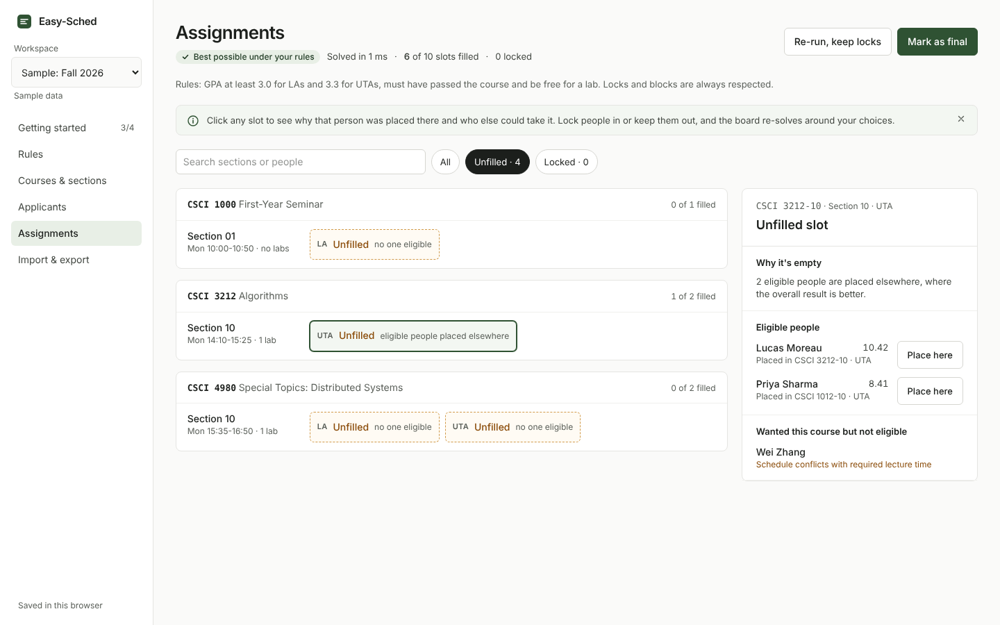
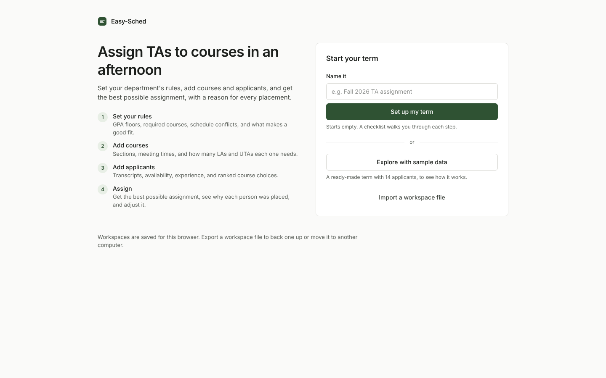
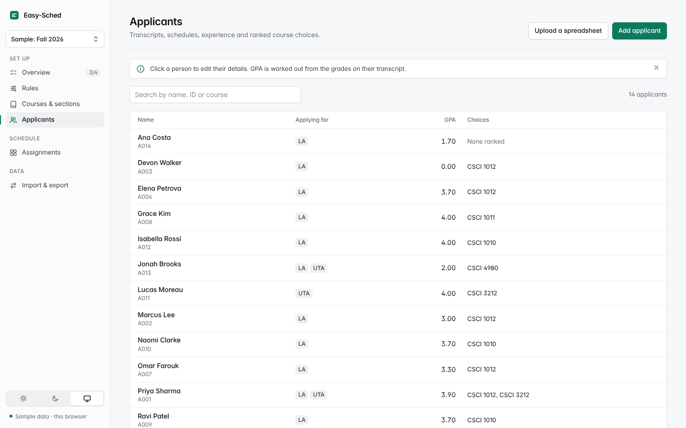

# Easy-Sched

Easy-Sched assigns student TAs and learning assistants to course sections. Load your courses and applicants, set your department's rules, and an exact matching solver proposes the best schedule, with a plain explanation for every placement and every empty slot. You then lock, adjust, finalize and export it.

**Live demo:** [easy-sched.onrender.com](https://easy-sched.onrender.com) (free hosting, so the first load can take up to a minute) · [Report a bug](https://github.com/OliverKris/easy-sched-reworked/issues)

<picture>
  <source media="(prefers-color-scheme: dark)" srcset="docs/screenshots/assignments-dark.png">
  
</picture>

## Features

- **Optimal assignments.** Max-weight bipartite matching (SciPy `linear_sum_assignment`) finds the highest-scoring schedule in milliseconds. The original CSP backtracking solver is still available for comparison.
- **Explanations.** Every slot shows its score breakdown, the next-best alternatives, why ineligible applicants were excluded, and why a slot stayed empty.
- **Department rule profiles.** Eligibility rules and scoring weights live in JSON files, not in code, so another department can bring its own.
- **Your data, your way.** Add and edit courses, sections and applicants in the app, or upload a CSV with a dry-run preview and a row-by-row error report.
- **You stay in control.** Lock a person into a slot, keep someone out, place people by hand, re-solve around your choices, then mark the schedule final.
- **Private workspaces, no account.** Each browser gets its own workspaces. Export a workspace to a file and import it anywhere (replace or merge).
- **CSV export** of the finalized schedule.
- **Light and dark themes**, undo for every change on the board, and a `/` shortcut to search.

## Quick start

You need **Python 3.12+**, **Node.js 20+** (with npm) and **Git**.

### 1. Clone the repo

```bash
git clone https://github.com/OliverKris/easy-sched-reworked.git
cd easy-sched-reworked
```

### 2. Start the backend

```bash
python -m venv .venv
source .venv/bin/activate        # Windows: .venv\Scripts\activate
pip install -r requirements.txt
cd backend
uvicorn api:app --reload
```

The API runs at http://127.0.0.1:8000, with interactive API docs at http://127.0.0.1:8000/docs. On first run it creates the SQLite database and seeds the sample data.

### 3. Start the frontend (in a second terminal)

```bash
cd frontend
npm install
npm run dev
```

Open http://localhost:5173. The Vite dev server forwards `/api` requests to the backend on port 8000, so start the backend first.

### Configuration

All settings are environment variables; none are required for local development.

| Variable | Default | What it does |
| --- | --- | --- |
| `EASY_SCHED_DB_PATH` | `backend/easy_sched.db` | Location of the SQLite database. Delete the file to reset all data. |
| `EASY_SCHED_DEMO_MODE` | off | Set to `1` on a public demo whose storage can be wiped. The app then tells people to export their work. |
| `EASY_SCHED_CORS_ORIGINS` | `http://localhost:5173` | Comma-separated origins allowed to call the API, if the frontend is hosted on a different domain. |
| `EASY_SCHED_FRONTEND_DIST` | `frontend/dist` | Built frontend that the backend serves in production. |

## Using the app

 

1. **Welcome.** Your first visit opens a short tour. Then pick a starting point: the sample term, a blank term, or a workspace file you exported earlier.
2. **Getting started.** A checklist tracks what is left to set up.
3. **Rules.** Choose which requirements are hard rules and how much each scoring factor counts.
4. **Courses and Applicants.** Add or edit rows in the side editor, or choose **Upload CSV**: download the template, fill it in, preview the result, fix any flagged rows, then merge with or replace what you have.
5. **Assignments.** Run the solver and click any slot to see why that person was chosen. Use **Lock**, **Keep out** and **Place here** to adjust, re-run to fill around your changes, then **Mark final** and download the schedule as CSV.
6. **Import & export.** Save a workspace file with any mix of settings, courses, applicants and the finalized schedule, and import it into a new or existing workspace.

> Workspaces are tied to your browser. Clearing site data removes access to them, so export a workspace file first if you need to keep it.

## CSV uploads

Each upload page links a template and lists the accepted columns. Values are written the way people already write them:

| Value | Examples |
| --- | --- |
| Days | `MW`, `TR`, `TTh`, `MWF` |
| Times | `2:20pm`, `14:20` |
| Transcript | `CSCI 1111: A-; CSCI 1112: B+` |
| Position | `LA`, `UTA` or `both` |

The preview checks every row and reports all problems in a row at once. Nothing is saved until the file is clean. Uploads are limited to 5,000 rows and 5 MB.

## Rule profiles

Profiles live in [`backend/profiles/`](backend/profiles) (`gwu_cs.json`, `example_math.json`). The format is documented in [`backend/profiles/README.md`](backend/profiles/README.md).

- **Hard rules** decide who is eligible: `applied_for_position`, `passed_course`, `no_lecture_conflict`, `conflict_free_lab`, `cmp` (compare any field), combined with `all`, `any` and `not`.
- **Scoring terms** rank eligible applicants: `course_grade`, `teaching_experience`, `recommendation_strength`, `preference_rank`, `skill_overlap` and `bonus`, each with a weight.

The rule compiler checks a profile against the known fields when it loads and turns it into eligibility and score tables for the solver, so the solver itself knows nothing about any one department.

## Architecture

| Layer | Technology | Where |
| --- | --- | --- |
| Frontend | React 19, TypeScript, Vite, Tailwind CSS v4, React Router, TanStack Query | `frontend/src/` |
| API | FastAPI, Pydantic v2 | `backend/api.py` |
| Rule compiler | JSON profiles compiled to eligibility and score tables | `backend/ta_assignment/rules/` |
| Solvers | Max-weight matching (default), CSP backtracking | `backend/ta_assignment/` |
| Storage | SQLAlchemy with SQLite; workspaces, CSV import, editing | `backend/ta_assignment/db/` |

The browser sends an anonymous `X-Client-Id` header with every request, and the API only opens workspaces that belong to that ID. In production the FastAPI app also serves the built frontend, so the whole product runs as one service.

## Project structure

```text
easy-sched-reworked/
├── backend/
│   ├── api.py              # FastAPI app and endpoints
│   ├── solve_view.py       # per-slot explanations
│   ├── profiles/           # department rule profiles (JSON)
│   ├── benchmarks/         # generator, runner, golden results
│   ├── tests/              # pytest suite
│   └── ta_assignment/
│       ├── matching_solver.py
│       ├── csp_solver.py
│       ├── rules/          # schema, fields, compiler
│       └── db/             # models, workspaces, CSV import, editing
├── frontend/
│   └── src/
│       ├── app/            # shell, router, workspace context
│       ├── features/       # onboarding, rules, courses, applicants, assign, data
│       ├── design/         # shared UI components
│       └── lib/            # API client, workspace files
├── Dockerfile              # one image: builds the frontend, runs the API
├── render.yaml             # Render deploy blueprint
└── requirements.txt
```

## Tests and benchmarks

```bash
cd backend
python -m pytest                              # full test suite
python -m benchmarks.run --solver matching    # time the solver on generated terms
python -m benchmarks.golden --update          # refresh golden results after an intended change
```

GitHub Actions runs the backend tests, lints and builds the frontend, and builds the Docker image on every push. Locally, `npm run lint` and `npm run build` in `frontend/` do the same checks.

## Deploy your own

The repo includes a [Render](https://render.com) blueprint that runs everything as one free web service.

1. Fork the repo and sign in to Render with GitHub.
2. Choose **New → Blueprint** and pick your fork. Render reads `render.yaml`, builds the `Dockerfile` and starts the service.
3. Later pushes to `main` deploy automatically once CI passes.

The free plan sleeps after about 15 minutes without traffic and has no persistent disk, so data resets when it sleeps or redeploys. Demo mode is on in the blueprint, so the app tells visitors to export their work. For lasting data, attach a disk (or use a host with volumes) and point `EASY_SCHED_DB_PATH` at it.

To run the production image locally:

```bash
docker build -t easy-sched .
docker run -p 8000:8000 easy-sched     # open http://localhost:8000
```

## Roadmap

- Change summary after each re-solve, a by-person view, and more keyboard shortcuts
- Fuller Rules screen: templates, more rule types, and how many applicants each rule excludes
- Custom roles beyond LA and UTA
- Collapsible navigation on phones

## License

See [LICENSE](LICENSE).
